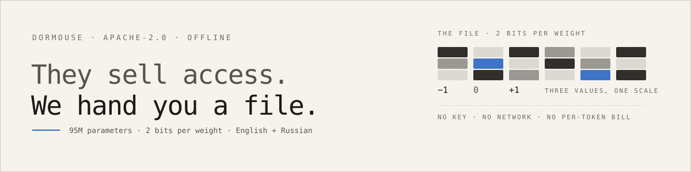

<p align="center">
  
</p>

<h1 align="center">dormouse · site</h1>

<p align="center"><em>They sell access. We hand you a file.</em></p>

<p align="center">
  <a href="https://dormouse-ai.github.io/site/">Landing page</a> ·
  <a href="https://dormouse-ai.github.io/site/docs/">Documentation</a> ·
  <a href="https://github.com/dormouse-ai/plan">The plan</a>
</p>

---

## What this repository is

One deployable: the product page at `/`, the documentation at `/docs/`, both published by
GitHub Pages from this repository alone.

| path | what | build |
|---|---|---|
| `index.html` | the landing page — one file, htmx, no build step | none |
| `partials/` | the evidence fragments htmx loads behind the three measured numbers | none |
| `assets/` | banner, favicon, and the vendored `htmx.min.js` | none |
| `docs/` | Astro + Starlight documentation | `npm run build` |
| `.github/workflows/pages.yml` | builds the docs, assembles both, deploys | — |

The landing page opens as a file. Everything except the htmx evidence panels works from `file://`,
because nothing about it needs a server: no bundler, no framework, no font requests.

## Run it locally

```bash
# the landing page — no install, no build
python3 -m http.server 8000        # then open http://localhost:8000/

# the documentation
cd docs
npm ci
npm run build                      # → docs/dist
npm run dev                        # or: live preview with reload
```

Serve the repository root rather than opening `index.html` directly: the htmx panels fetch
`partials/*.html`, and browsers refuse that XHR under `file://`. The page degrades to a plain link
in that case — it does not break.

## How it is deployed

`.github/workflows/pages.yml` runs on every push to `main`:

1. `npm ci && npm run build` inside `docs/` → static HTML;
2. assemble `_site/` — landing files at the root, `docs/dist` under `_site/docs/`, plus
   `.nojekyll` so GitHub Pages does not filter the `_astro/` directory;
3. assert the artifact: `index.html`, `404.html`, `docs/index.html`, the vendored htmx, and that
   no internal link is missing its base path;
4. upload and deploy.

The URL a project site gets is `/<repo>/`, so the docs are served from `/<repo>/docs/`.
`docs/base.mjs` derives that base once, from `GITHUB_REPOSITORY`, and both the Astro config and
a post-build rewrite read it — if this repository ever becomes the organisation's
`<org>.github.io` root site, the base becomes `/docs` and nothing else changes.

## The three numbers on the landing page

Each carries the run it came from, because a loss without its window is an anecdote.

| number | what it means | source |
|---|---|---|
| **87 kB/s** | bytes learned per second by the 95M model on one RTX 5070 Ti, 16 GB | measured, 60-day budget table |
| **1.222 BPB** | held-out bits per byte after 2.64 GB, fixed 196,608-byte window (`xz`: 2.31) | `logs/arch/run2640_ternary.jsonl` |
| **3.4×** | bytes per second gained by a 32k joint ru/en BPE unit at equal quality | measured before the next run |

An earlier record, **1.936 BPB**, was measured on the corpus *before* the 2026-11-08 refetch. It
is in the project's archive and deliberately not on the landing page: a number from a different
window is a different number, and putting the two in one column would be the exact dishonesty the
project is built against.

## Contrast (computed, not eyeballed)

WCAG 2.1 relative luminance, `(L1 + 0.05) / (L2 + 0.05)`. Every pair used for text clears AA
(4.5:1 normal, 3:1 large). The table is the token sheet; the same ratios were re-checked in the
rendered page for every text node in both themes — 0 failures on the landing page and in the docs.

| pair | light | dark |
|---|---:|---:|
| ink on paper | 15.70 | 15.79 |
| secondary text on paper | 6.91 | 7.48 |
| tertiary text / labels on paper | 4.86 | 5.03 |
| accent on paper | 5.02 | 7.65 |
| ink on panel | 17.12 | 15.03 |
| secondary text on panel | 7.54 | 7.12 |
| tertiary text on panel (dark stage) | 5.29 | 4.79 |
| accent on panel (dark stage) | 5.47 | 7.29 |
| primary button: paper on ink | 15.70 | 15.79 |

The one colour from the brief that did **not** clear AA was `#2f6fd0` at 4.40:1 on the paper
background, so the palette uses the product's existing accent `#2a66c2` (5.02:1) instead.

## Accessibility and quality

- `lang="en"` on the landing page; Starlight sets `lang` on every documentation page.
- One `<h1>` per page, landmarks (`nav`, `main`, `header`, `footer`), a skip link, visible
  `:focus-visible` rings, `aria-label` on the icon-only theme control.
- Motion is opt-in: drift, reveals and hover lifts are all disabled under
  `prefers-reduced-motion: reduce`, and nothing is hidden when JavaScript is off.
- No layout shift: system fonts only, no image without intrinsic dimensions, the fixed nav is
  priced into `scroll-padding-top`.
- A `404.html` at the root and a Starlight 404 in the docs.

## Documentation map

| page | what it answers |
|---|---|
| [Getting started](https://dormouse-ai.github.io/site/docs/getting-started/) | install, train, gate, export |
| [Architecture](https://dormouse-ai.github.io/site/docs/architecture/) | the block, Muon, TSCT, the runtime invariants |
| [Formats](https://dormouse-ai.github.io/site/docs/formats/) | bf16 → 4-bit → ternary, and the export container |
| [Measurement](https://dormouse-ai.github.io/site/docs/measurement/) | the loss · window · budget rule and the current record |
| [Roadmap](https://dormouse-ai.github.io/site/docs/roadmap/) | bigger stored, same active; what is out of reach |

Every page that names a technology ends with the papers it leans on, by arXiv id.

## Licence

Apache-2.0 — the site, like the weights.

---

# dormouse · сайт

<p align="center"><em>Они продают доступ. Мы отдаём файл.</em></p>

## Что это за репозиторий

Один деплой: страница продукта в корне и документация в `/docs/`, которые GitHub Pages
публикует из этого репозитория целиком.

| путь | что | сборка |
|---|---|---|
| `index.html` | лендинг — один файл, htmx, без сборки | нет |
| `partials/` | фрагменты-доказательства, которые htmx подгружает под тремя числами | нет |
| `assets/` | баннер, фавикон и `htmx.min.js` рядом, без CDN | нет |
| `docs/` | документация на Astro + Starlight | `npm run build` |
| `.github/workflows/pages.yml` | собирает документацию, складывает обе части, деплоит | — |

Лендинг открывается как файл. Всё, кроме панелей с доказательствами, работает из `file://`:
ни бандлера, ни фреймворка, ни запросов за шрифтами.

## Запустить локально

```bash
# лендинг — ничего ставить и собирать не нужно
python3 -m http.server 8000        # затем http://localhost:8000/

# документация
cd docs
npm ci
npm run build                      # → docs/dist
npm run dev                        # живая пересборка
```

Открывайте корень репозитория через сервер, а не двойным щелчком по `index.html`: панели
htmx запрашивают `partials/*.html`, а браузер запрещает такой запрос из `file://`. В этом
случае страница откатывается к обычной ссылке — она не ломается.

## Как это публикуется

`.github/workflows/pages.yml` срабатывает на каждый пуш в `main`:

1. `npm ci && npm run build` внутри `docs/` → статический HTML;
2. сборка `_site/` — файлы лендинга в корне, `docs/dist` в `_site/docs/`, плюс `.nojekyll`,
   чтобы GitHub Pages не отфильтровал каталог `_astro/`;
3. проверка артефакта: есть `index.html`, `404.html`, `docs/index.html`, вендоренный htmx и
   ни одна внутренняя ссылка не потеряла базовый путь;
4. загрузка и деплой.

Project-сайт получает адрес `/<repo>/`, поэтому документация живёт на `/<repo>/docs/`.
`docs/base.mjs` вычисляет этот базовый путь один раз, из `GITHUB_REPOSITORY`, и его читают и
конфиг Astro, и пост-обработка: если репозиторий когда-нибудь станет корневым
`<org>.github.io`, базой станет `/docs` и больше ничего менять не придётся.

## Три числа на лендинге

У каждого назван прогон, из которого оно взято: лосс без окна — это анекдот.

| число | что значит | источник |
|---|---|---|
| **87 кБ/с** | сколько байт в секунду выучивает модель 95M на одной RTX 5070 Ti, 16 ГБ | замер, таблица бюджета на 60 дней |
| **1.222 BPB** | бит на байт на отложенном окне после 2.64 ГБ, окно 196 608 байт (`xz`: 2.31) | `logs/arch/run2640_ternary.jsonl` |
| **3.4×** | во сколько раз больше байт в секунду даёт BPE на 32k (ru+en) при том же качестве | замер до следующего прогона |

Более ранняя запись, **1.936 BPB**, измерена на корпусе *до* пересбора 2026-11-08. Она лежит в
архиве проекта и сознательно не попала на лендинг: число с другого окна — это другое число, а
поставить их в одну колонку было бы ровно той нечестностью, против которой построен проект.

## Контраст (посчитан, а не на глаз)

Относительная яркость по WCAG 2.1, `(L1 + 0.05) / (L2 + 0.05)`. Все пары для текста проходят
AA (4.5:1 для обычного, 3:1 для крупного).

| пара | светлая | тёмная |
|---|---:|---:|
| основной текст на бумаге | 15.70 | 15.79 |
| вторичный текст на бумаге | 6.91 | 7.48 |
| третичный текст и подписи | 4.86 | 5.03 |
| акцент на бумаге | 5.02 | 7.65 |
| текст на панели | 17.12 | 15.03 |
| вторичный текст на панели | 7.54 | 7.12 |
| подписи на тёмной сцене | 5.29 | 4.79 |
| акцент на тёмной сцене | 5.47 | 7.29 |
| кнопка: бумага на чернилах | 15.70 | 15.79 |

Единственный цвет из брифа, который **не** прошёл AA, — `#2f6fd0`: 4.40:1 на бумаге. Поэтому
палитра использует существующий акцент продукта `#2a66c2` (5.02:1).

## Доступность и качество

- `lang="en"` у лендинга, `lang` на каждой странице документации; русский текст в README
  лежит отдельным разделом, а не безымянным блоком без языка.
- Один `<h1>` на страницу, ориентиры (`nav`, `main`, `header`, `footer`), ссылка «к
  содержанию», видимое кольцо `:focus-visible`, `aria-label` у кнопки темы.
- Движение выключается: дрейф сетки, появление секций и подъём карточек отключены при
  `prefers-reduced-motion: reduce`, и ничего не спрятано без JavaScript.
- Нет сдвига макета: только системные шрифты, у изображений заданы размеры, фиксированная
  навигация учтена в `scroll-padding-top`.
- `404.html` в корне и страница 404 внутри документации.

## Карта документации

| страница | на какой вопрос отвечает |
|---|---|
| [С чего начать](https://dormouse-ai.github.io/site/docs/getting-started/) | установка, обучение, гейт, экспорт |
| [Архитектура](https://dormouse-ai.github.io/site/docs/architecture/) | блок, Muon, TSCT, инварианты в рантайме |
| [Форматы](https://dormouse-ai.github.io/site/docs/formats/) | bf16 → 4 бита → тернар, контейнер экспорта |
| [Измерения](https://dormouse-ai.github.io/site/docs/measurement/) | правило «лосс · окно · бюджет» и текущий рекорд |
| [План](https://dormouse-ai.github.io/site/docs/roadmap/) | больше хранимых при тех же активных; что недостижимо |

Каждая страница, где названа технология, заканчивается статьями, на которые опирается, — с
идентификатором arXiv.

## Лицензия

Apache-2.0 — сайт, как и веса.
